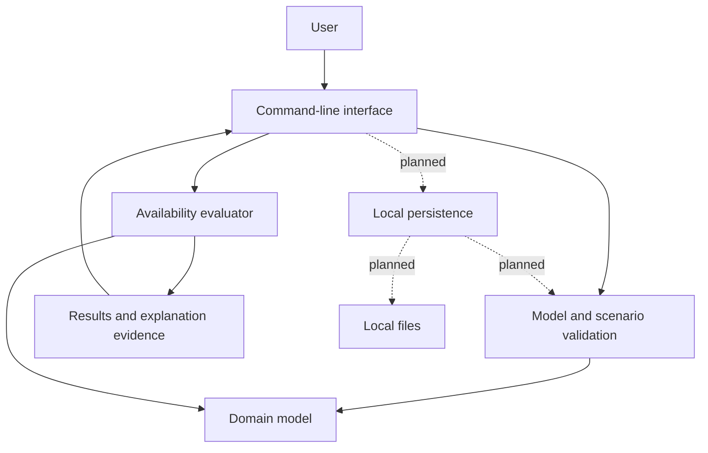

# OpSecMap — System Architecture

**Status:** Design specification; implementation in progress.

**Scope:** Local modeling and scenario analysis of account-access dependencies.

## 1. Overview

OpSecMap models the resources and procedures required to access or recover digital
accounts. Its primary analysis evaluates the consequences of losing a device,
credential source or existing account access, and identifies documented recovery
routes that remain feasible.

The system represents conjunctive prerequisites and alternative procedures
explicitly. Evaluation produces scenario-relative results with supporting evidence
and unresolved requirements. It does not assign a global security score or infer
that an incompletely documented account is secure.

The initial delivery target is a native Rust command-line application. A graphical
map is a subsequent presentation layer over the same domain model and evaluator.

### Implementation status

The repository currently implements validated resource and route value objects,
resource and route storage with reference checks, scenario inputs, and an in-memory
evaluator that follows routes to a fixed point and records missing prerequisites
for unresolved routes. The CLI runs one hard-coded example and does not print
blocked-route details. Loading personal maps, persistence, encrypted storage,
documentation coverage, and graphical presentation remain under development.
Requirements in this document describe the intended complete behavior; they are
not assertions about security controls that have not yet been implemented.

## 2. Scope and assumptions

The initial analysis addresses availability and account recovery. It operates on
user-supplied descriptions of resources, procedures and incident conditions.
Provider-specific requirements are inputs to the model, not discovered or verified
by the application.

The following analyses are outside the initial scope:

- attacker access, credential compromise and confidentiality loss;
- restoration or integrity of the data held by an account;
- recovery-code consumption, procedural side effects and mutually exclusive actions;
- timing constraints, recovery delays and probabilistic outcomes;
- automatic discovery, execution or verification of provider recovery procedures.

Account recovery does not imply data recovery. A functioning backup or recovery
route does not establish protection against compromise. These concerns require
separate models rather than additional interpretations of an availability result.

The application is designed for local operation without a backend, telemetry,
network access during evaluation or elevated operating-system privileges.

## 3. Component architecture

The initial implementation uses a single Cargo package with library and binary
targets. Component boundaries are logical; they do not require separate crates.



| Component | Responsibility |
| :--- | :--- |
| Domain model | Resource identity, procedures and scenario inputs; documentation coverage is planned |
| Validation | Referential integrity, structural constraints and scenario consistency |
| Evaluator | Deterministic calculation of accessible resources and supporting evidence |
| Presentation | User interaction, diagnostics and rendering of evaluation results |
| Persistence (planned) | Versioned serialization, local file operations and encrypted storage |

Domain validation and evaluation are independent of terminal I/O and filesystem
operations. Presentation layers consume structured results rather than reimplement
recovery rules. Persistence validates decoded data before it becomes active state;
a failed load must not replace the current valid map.

The initial evaluator uses Rust collections and explicit iteration. No Datalog
engine, plugin mechanism or multi-crate workspace is required by this design.

## 4. Domain model

### 4.1 Resources

A resource represents an account, device, credential reference or reference to
recovery material. Each resource has a stable identifier and an editable label.
Labels are descriptive and are not used as reference keys.

A resource may serve multiple roles. Descriptive roles do not themselves grant
access or imply dependencies: those relationships are expressed through routes.
The precise role taxonomy and identifier representation remain implementation
choices subject to the constraints in this document.

The map stores descriptions and references, not passwords, private keys or
recovery-code values. For example, a resource may identify an offline recovery
sheet without containing the codes written on it.

### 4.2 Routes

A route represents a named access or recovery procedure with one target resource
and a non-empty set of prerequisite resources. Every prerequisite must be
accessible for the route to succeed. Multiple routes to the same target are
alternatives: any satisfied route can establish access.

This is a directed AND/OR dependency model, equivalently a directed hypergraph
whose hyperedges connect prerequisite sets to individual targets. A list of
independent binary edges is insufficient to express the conjunction within a
route unless route grouping is retained.

Example: an email account may have a login route requiring both a password source
and an authenticator, plus a recovery route requiring independently held recovery
material. The recovery route is valid only if those prerequisites accurately
represent that provider's procedure; a recovery code is not assumed to replace
all other authentication requirements.

### 4.3 Scenarios

A scenario currently specifies:

- resources explicitly available at the start of evaluation;
- resources excluded from availability for the duration of the scenario;

An incident description and other narrative assumptions are planned for a
future input format; they are not fields of the current `Scenario` type.

Loss of current account access is represented by absence from the initial set;
the account may subsequently become accessible through a route. Irretrievable
loss of a physical device excludes that device from the scenario entirely.
An excluded resource cannot be restored by the evaluator. Conflicting initial
availability and exclusion declarations are validation errors.

Existing authenticated sessions are not inferred. Availability of such a session
must be represented explicitly when relevant to an analysis.

### 4.4 Documentation coverage

Documentation coverage is planned and is not stored by the current model. A
future input may let the user mark a target's routes as complete or
incomplete/unknown. Such a mark would describe supplied information, not
independent verification of provider policy.

Coverage is separate from accessibility. A known working route may establish
access even when additional routes are undocumented. Failure to establish access
from an incomplete map cannot establish real-world impossibility of recovery.

### 4.5 Structural invariants

A valid model has unique identifiers, existing route targets and prerequisites,
and non-empty prerequisite sets. Duplicate prerequisites are rejected. The
current map has no resource deletion operation; any future deletion must preserve
reference integrity. Renaming does not change identity.

Cycles are valid model structures. They may represent circular recovery
requirements and must not be rejected solely because they prevent topological
ordering. Shared prerequisites also represent common-cause dependencies: copies
stored on the same device are not independent merely because they have separate
labels.

## 5. Evaluation semantics

Let:

- V be the finite set of resources;
- R be the set of routes, each with prerequisites P(r) and target t(r);
- I be the initial available set;
- D be the scenario-excluded set, with I intersect D empty.

Evaluation computes the least fixed point of:

```text
A₀ = I
Aₖ₊₁ = Aₖ ∪ { t(r) | r ∈ R, P(r) ⊆ Aₖ, t(r) ∉ D }
```

The resulting set contains exactly the resources derivable from the documented
routes and declared initial availability under these semantics. Each round either
adds resources or terminates. At most |V| strict-expansion rounds are possible.

A cycle without an available prerequisite or independent entry route does not
bootstrap itself. A cycle with an external entry can become accessible through
successive derivations. The evaluator does not execute recovery procedures or
model their side effects.

### Explanation evidence

Each derived resource records the route chosen as its witness. The map provides
that route's prerequisites, but the current evidence record does not duplicate
their evidence or store derivation-round numbers. A route can only use access
known before its expansion round, so witnesses are rooted in initial availability
even when the map contains cycles. Witness selection and result ordering are
deterministic. Exhaustive enumeration and optimization of recovery plans are
outside the initial contract.

For unsuccessful routes to unresolved, non-excluded targets, the evaluator records
missing prerequisites. Coverage warnings about incomplete documentation are planned;
they are not implemented yet. The initial evaluator does not estimate hypothetical
recovery paths or probabilities.

## 6. Result contract

Evaluation separates positive evidence, unresolved access and information quality:

| Observation | Meaning |
| :--- | :--- |
| Initially available | Availability supplied by the scenario |
| Derived access | A documented route has satisfied prerequisites, with witness evidence |
| No working documented route | Access was not derived; unmet requirements are reported |
| Coverage warning (planned) | Missing documentation or unsupported assumptions limit interpretation |

A future coverage feature would present an unresolved target with incomplete
documentation as indeterminate. Today, failure means no route works within the
supplied model; it is not a guarantee about undocumented provider behavior.

The caller retains the scenario assumptions; the evaluation records which access
was initial and which was derived from a route.
Interface complexity settings may change presentation detail, but not evaluation
semantics. No output category represents an account as globally safe.

## 7. Persistence and trust boundaries

### Storage contract

Planned persistence will use a versioned representation of resources, routes and
map metadata.
The file format and migration policy will be specified before persistence is
released. Plaintext JSON is suitable for development fixtures and explicit export;
normal storage of personal maps requires authenticated encryption.

Reads, validation and state replacement are separate operations. Malformed input,
unsupported versions and failed decryption must leave existing application state
unchanged. Failed saves must preserve the previous valid file. Input size and
resource usage limits apply before expensive decoding or key derivation.

### Confidentiality requirements

The dependency map is sensitive even when it contains no secret values: labels,
notes and relationships may disclose recovery channels and concentrations of access.
Encrypted storage is therefore a prerequisite for supported personal-data use.

Password-based key derivation and authenticated encryption must use maintained
libraries. Argon2id and AES-256-GCM are candidate primitives; library selection,
parameter policy, envelope format, metadata authentication and nonce management
remain subject to the persistence specification and review.

The implementation must avoid plaintext temporary files and sensitive logs, make
plaintext export explicit, and document password handling and memory-clearing
limitations. There is no server-assisted password reset. Loss of the map password
and backup/recovery of the map itself are part of the storage design.

### Trust boundaries

| Boundary | Required property |
| :--- | :--- |
| User input → domain state | Structural and scenario validation before acceptance |
| Local file → active map | Bounded parsing, version checks and validation before state replacement |
| Encrypted file → decoded content | Authentication before accepting plaintext as map data |
| Domain results → interface | Preserve evidence, assumptions and uncertainty without changing semantics |
| Application distribution → execution | Trust in application code and updates remains necessary |

Encryption at rest does not protect an unlocked map from a compromised host,
screenshots or malicious application code. A web distribution would additionally
require a policy for script delivery, dependencies and updates. The
[current security assessment](security-assessment.md) lists implemented controls
separately from future storage requirements.

## 8. Verification requirements

Validation and evaluation tests cover these reference scenarios:

| Scenario | Expected result |
| :--- | :--- |
| Phone lost; independent recovery material available | Login route fails; documented alternative succeeds |
| Password available; required authenticator unavailable | Conjunctive route remains unsatisfied |
| A depends on B and B on A; neither initially available | Neither is derived |
| Same cycle with an independent route to A | A and subsequently B are derived |
| Recovery material available only through the locked account | No independent recovery is derived |
| One of two alternative routes is satisfied | Target access is derived |
| No routes documented and coverage unknown (planned) | An eventual coverage report should mark the interpretation as indeterminate |

Evaluator properties include determinism, termination on finite cyclic models,
valid witness evidence and preservation of scenario exclusions. For a fixed model
and exclusion set, adding initial availability cannot reduce the accessible set.
Removing routes cannot increase it.

Persistence verification includes round trips, malformed inputs, unsupported
versions, interrupted saves and retention of prior valid state. Encryption tests
include wrong passwords, modified ciphertext, malformed metadata and resource
limits. These tests establish implementation behavior within the model, not the
accuracy of user-supplied recovery procedures.

## 9. Extension points and open decisions

| Area | Current position |
| :--- | :--- |
| Graphical interface | Later presentation layer; must preserve route grouping, explanations and textual accessibility |
| Browser deployment | Rust/WASM with a web frontend is an option; no framework or binding library is mandated |
| Data restoration | Separate future analysis of backup contents, freshness and restore requirements |
| Compromise | Separate future analysis of attacker capabilities and confidentiality consequences |
| Common-cause failures | Shared prerequisites and multi-resource exclusions initially; explicit failure groups deferred |
| Persistence | Exact schema, format identifiers, migrations and cryptographic envelope pending specification |
| Resource representation | Stable identifier implemented; descriptive role vocabulary remains open |

A graphical interface must provide keyboard operation and a textual alternative,
and must not communicate result meaning through color alone. New analyses must
state their own assumptions without silently changing existing recovery semantics.

The architectural baseline is a validated AND/OR model, deterministic reachability
and explainable results. Additional components require concrete requirements;
they are not prerequisites for this baseline.
