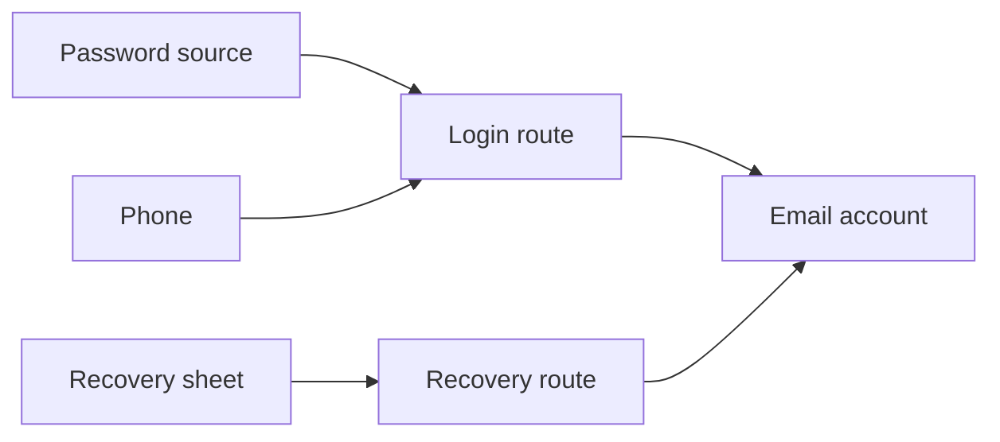

# Explanation: System Architecture

This page gives a short explanation of the current model. The
[architecture document](https://github.com/onyks-os/OpSecMap/blob/main/docs/architecture.md)
describes the intended system in more detail.

---

## Resources, routes and scenarios

A resource represents something a person may need access to, such as an account,
device or recovery sheet. A route describes one way to reach a target resource.
Every prerequisite in that route must already be accessible. Multiple routes to
the same target are alternatives.

A scenario identifies resources available at the start and resources excluded for
the entire evaluation. An excluded resource cannot be recovered through a route.

## Evaluation

The login route needs both the password source and phone. The recovery route can
establish access through the sheet instead. The evaluator starts from available
resources, applies usable routes, then repeats until no new resources can be
reached. It records an initial or route-based reason for each accessible resource
and missing prerequisites for routes to unresolved targets.
Cycles do not create access on their own; a route into a cycle must first become
usable from available resources.

## Current limits

The evaluator works on an in-memory Rust map. The CLI currently creates one fixed
example, so there is no way to enter a personal map through the application. The
model does not verify that an account provider will honor the documented recovery
procedure. Local storage, encryption, a graphical view, documentation coverage
and CLI output for blocked routes are planned work.

The model describes availability after a loss. It does not analyze credential
compromise, data integrity or whether backups contain recoverable data.
